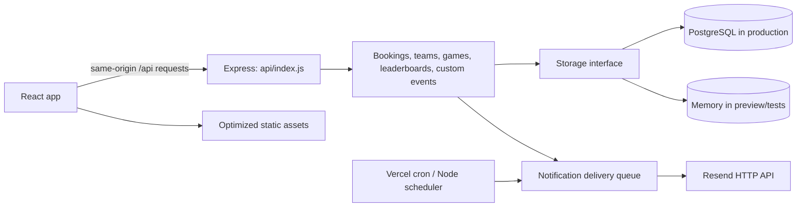

# Transilvania Trivia

The Romanian/English website for the weekly quiz at Insomnia Cafe & Bistro in Cluj-Napoca. It handles event registration, accounts and teams, five weekly games, historical leaderboards, theme suggestions, administrator tools, and independent custom events such as `/hermes`.

This README describes the current application. The dated reports in [`docs/`](docs/) record earlier implementation and audit results; their older setup instructions and test counts may have been superseded.

## Run locally

Use **Node.js 22.12 or newer** and npm. From the repository root:

```sh
npm ci
npm run dev:local
```

Open **http://localhost:3333**. The disposable preview includes a sample leaderboard and a custom event at **http://localhost:3333/hermes**. Open `/admin` with the local-only password **`local-trivia-admin`**.

This preview deliberately does not read `.env`, connect to the live database, send email, or start the notification scheduler. Everything is stored in memory and resets when the process restarts. Its sample event has a fixed capacity of three teams. Set `PORT` when starting it if port 3333 is already occupied.

For ordinary development with your own database/settings, copy [`.env.example`](.env.example) to `.env`, fill only the settings you need, and run `npm run dev`. This starts Express and Vite together on port 3333 and starts the mail scheduler. With no database URL, development uses memory storage; production requires PostgreSQL. Real database/email settings are used by this command, so use a development database for development work.

## How the application works



The frontend uses React 18, TypeScript, Wouter, TanStack Query, Tailwind CSS, Framer Motion, and accessible Radix UI primitives. The backend uses Express, Drizzle, PostgreSQL, and Zod validation. One application entry point supports both Vercel functions and a long-running Node server.

### Pages and navigation

| URL | Behavior |
| --- | --- |
| `/` | Main site: event details/calendar, registration, confirmed teams, weekly games, leaderboard, rulebook, team area, prizes, and footer. Section links use hash anchors. |
| `/cont` | Signed-in profile, account details, team management, and theme history. |
| `/admin` | Separate administrator login and management interface. |
| `/:slug` | A published custom-event page. Unknown or unpublished events display the not-found page. |
| `/api/*` | JSON/image API, handled by Express rather than client-side routing. |

Account/admin/custom-event pages and the individual games are loaded on demand. The globe's larger WebGL dependencies load when its game is first opened. A page error boundary provides reload recovery for failed lazy downloads or render errors. Romanian is the default language; the language toggle changes authored interface text and puzzle content without translating user-entered names or event copy.

### Weekly events, bookings, and teams

[`shared/schedule.ts`](shared/schedule.ts) defines the authored season calendars and derives the current/next edition, breaks, date, and edition identifier. Dates use `Europe/Bucharest`, including daylight-saving changes. The existing season templates need editorial review for future years; the application does not invent new event dates.

Guests register with contact details. A signed-in team captain can instead register the existing account-linked team; the server derives its identity and contact details from the authenticated account. A team can have up to six account members, with invite-code joining and captain-controlled membership/leadership changes.

Weekly capacity starts at 10, expands to 12 after the ninth confirmed team, and to 15 after the eleventh. Further submissions join the waiting list. Administrators manage approvals and overrides. Mutations serialize capacity/duplicate checks, and new registrations respect an existing waiting list. Public responses expose confirmed team information without contact details.

### Weekly games and secret clue

The five games are Wordle, Reach the Target, Timeline, Connections, and Globle. Authored Romanian/English content rotates through 40 weekly sets. Wordle dictionaries and country boundary/name data are runtime assets, not disposable development files.

The reset is **Wednesday at 00:00 in Bucharest**. [`shared/puzzle-week.ts`](shared/puzzle-week.ts) computes calendar-based week boundaries and `week-YYYY-MM-DD` keys. The browser synchronizes with `/api/puzzles/week`, schedules the next reset, and rechecks on focus/visibility changes. A week change remounts the game boards and clears old completion state; stale-week API writes are rejected.

Authenticated team members share completion records in `app_weekly_puzzle_progress`. Completing all five current games unlocks the clue for that week's scheduled edition. Weeks without an event have games but no event clue. The administrator simulator is a session-local preview; it does not move other players to a different week or save preview solves as live progress.

Puzzle answers are shipped to the browser and solves are client-reported. This is a casual puzzle gate, not a server-validated competitive anti-cheat system.

### Leaderboards

The administrator uploads an `.xlsx` workbook, selects its season/year, reviews a preview, then publishes it. A team-name column is followed by edition-score columns and a final total column (`Scor Final` / `Overall score`); individual total cells may be blank. The importer validates scores and dates, recomputes totals, treats a zero as participation, and does not publish unplayed editions. Re-uploading replaces supplied edition results while preserving other imported editions/seasons.

Separate leaderboard identities support teams that do not have website accounts. Exact normalized names can link automatically; the administrator can link or unlink identities manually. Public tables offer overall, season, and edition views, and linked teams see their standing in the team area. Scores are stored as integer hundredths to preserve decimal results. The example workbook in `tests/fixtures/` is also used by the disposable preview.

### Custom events and collaborator logos

The custom-event editor controls the name, URL slug, headline, subtitle, Romanian date/time, venue/address, fee label, publication, registration opening, team capacity, three prizes, and optional collaborator name/logo. Custom events use their own registration scope (`event:<id>`), independently of weekly editions. Capacity changes only when the administrator changes it; there is no automatic 10/12/15 progression. Registered events cannot be deleted; unpublish them to remove public access while retaining bookings.

The custom page contains the brand/collaborator logos, authored event details, registration form, confirmed teams, prizes, and a main-site link. It does not include the weekly games or seasonal jackpot.

PNG originals are prepared in the admin browser before upload: proportions and transparency are preserved, fully transparent outer margins are trimmed, and the artwork fits inside a centered square of at most 1024px and 1 MiB. Inputs may be up to 20 MiB, 128 MiPixels, and 16384px per side, including 10660 × 10660 images. Above 40 MiPixels the browser must return a requested proportional working bitmap of at most 2048px per edge; unsupported resizing produces a friendly error rather than an unrestricted image fallback. Browser decoding can still require temporary native memory. The server independently validates the prepared PNG. Only published collaboration events expose their logo publicly; draft previews require admin authentication.

### Theme suggestions

`ThemeValidator` submits a proposed quiz topic to the server. The active scoring engine combines recognized subject domains, Wikipedia article/category data, and public trivia-source signals, with bounded in-process caches and timeout/fallback handling. The result is guidance on a topic's suitability and breadth. Signed-in teams can submit suggestions; administrators approve, reject, or delete them. This scoring code remains in use even though it is separate from weekly puzzle content.

### Authentication, administration, and email

Player authentication uses server-side `express-session` sessions: HttpOnly, SameSite=Lax cookies, with Secure cookies in production. Sessions persist in PostgreSQL; passwords use salted scrypt hashes. Password reset, password changes, and account deletion revoke relevant access. Team operations enforce ownership and membership on the server. Legacy plaintext passwords upgrade on successful login.

Administrator access uses a **separate persisted credential**, checked through `X-Admin-Password`. It is independent of player roles and the old `ADMIN_PASSWORD` environment variable. Database initialization seeds the configured bootstrap hash in `server/admin-credential.ts` only when the dedicated credential is missing; existing credentials are preserved. The disposable preview explicitly substitutes its own local password.

Emails include welcome, reset-code, confirmed/waiting registration, reminders, and current-week game-completion messages. Linked-team mail resolves actual team members with individual greetings; guests notify the submitted contact. Registration messages follow the signup language, while welcome/game-completion messages follow each recipient's account language. Delivery records are durable in production, with leases, retry state, relevance checks, and provider idempotency keys. Missing Resend credentials or failed requests leave queued messages pending; provider acceptance does not prove inbox delivery.

Weekly reminders become eligible after noon Bucharest time on event day; custom-event reminders use the preceding 24-hour window. A long-running server checks mail every five minutes. Vercel calls `/api/cron/notifications` at **10:00 UTC daily**, as configured in `vercel.json`; `CRON_SECRET` protects the endpoint. Daily cron means a failed run may need a manual retry before the event. The admin email section previews templates and shows delivery state; previewing does not send mail.

## Project layout and component guide

```text
api/                 Express/Vercel entry point
assets/source/       Canonical PNG masters, outside the static deployment
client/public/       Live WebP artwork, email PNG, favicon, and country data
client/src/          React pages, feature components, hooks, styles, game data
docs/                Dated implementation and audit reports
migrations/          Historical Drizzle SQL/snapshot history
script/              Build, local preview, tests, and maintenance commands
server/              API routes, services, persistence, notifications, tests
shared/              Models, validation, scheduling, and shared game utilities
tests/               Desktop/mobile browser suites and their fixtures
schema.sql           Current idempotent PostgreSQL setup and additive upgrades
```

### React pages and feature components

All paths below are relative to `client/src/`.

| File | Responsibility |
| --- | --- |
| `main.tsx`, `App.tsx` | Mount React/styles; install query/auth providers, language control, toast host, error boundary, and routes. |
| `pages/Home.tsx` | Compose the homepage, load current schedule/team data, poll updates, and synchronize navigation/section highlighting. |
| `pages/Account.tsx` | Profile editing, team/account actions, and personal theme history. |
| `pages/AdminPanel.tsx` | Admin authentication and tabs for editions, registrations, teams, users, themes, simulator, email, leaderboards, and custom events. |
| `pages/CustomEvent.tsx` | Load and render a standalone published event, registration state, and optional collaboration header. |
| `pages/not-found.tsx` | Missing-page response and link home. |
| `components/Navbar.tsx` | Desktop navigation, mobile menu, authentication/profile entry, and animated active-section indicator. |
| `components/HeroSection.tsx` | Main logo, event summary, countdown, registration button, and calendar. |
| `components/LiveRegistrationSection.tsx` | Shared weekly/custom registration form for guest contacts and signed-in captains. |
| `components/RegisteredTeamsGrid.tsx` | Public confirmed-team list and capacity display. |
| `components/TeamRegistrationStatus.tsx` | Upcoming registrations associated with the signed-in team. |
| `components/MiniGamesHub.tsx` | Lazy game tabs, shared completion fetch/save/reset, preview handling, week/account remounting, and clue gate. |
| `components/games/WordleGame.tsx` | Word guessing, dictionary checks, keyboard, and letter scoring. |
| `components/games/TargetGame.tsx` | Short arithmetic puzzle with undo, restart, and hint. |
| `components/games/TimelineGame.tsx` | Order historical events, with touch and keyboard-friendly placement controls. |
| `components/games/ConnectionsGame.tsx` | Find four groups of related words. |
| `components/games/GlobleGame.tsx` | Country guessing on a lazy WebGL globe; pause rendering when hidden. |
| `components/games/SecretClueModal.tsx` | Present the eligible week's revealed clue. |
| `components/LeaderboardSection.tsx` | Overall/season/edition standings, sorting/ranks, filters, and bilingual labels. |
| `components/RulebookSection.tsx` | Current rules, quiz format, and special mechanics. |
| `components/ThemeValidator.tsx` | Interactive topic scoring, feedback, and authenticated suggestion submission. |
| `components/TeamDashboard.tsx` | Team membership, invitations, captain actions, registration status, and linked leaderboard standing. |
| `components/AuthModal.tsx` | Login, signup, password reset, and team creation/joining flows. |
| `components/PrizesSection.tsx` | Shared prize illustrations and descriptions; weekly jackpot/venue content appears only in weekly mode. |
| `components/FooterSection.tsx` | Venue, social/contact information, and footer navigation. |
| `components/AdminCustomEvents.tsx` | Event editor, publication/capacity controls, booking management, prizes, and logo preparation/preview. |
| `components/AdminLeaderboard.tsx` | Workbook preview/publish and account-team identity linking. |
| `components/AdminEmails.tsx` | Bilingual email previews, provider configuration state, and delivery history. |
| `components/LanguageToggle.tsx` | Switch the current interface language. |
| `components/PageErrorBoundary.tsx` | Display recoverable page-load/render errors. |
| `components/ui/` | Used UI primitives: alerts/dialogs, badge/button/card, dropdown/select, form/input/label, progress, tabs, and toast host. |

### Client state, data, and styles

| File/directory | Responsibility |
| --- | --- |
| `lib/auth-context.tsx` | Session user, team, members, and login/logout/team API actions; refresh/cancellation protection. |
| `lib/queryClient.ts` | TanStack Query fetch defaults and shared query cache. |
| `lib/leaderboard.ts` | Reusable cached leaderboard query used by standings and the team dashboard. |
| `lib/i18n.ts`, `lib/locales/` | Romanian/English state, authored UI catalog, scoring-note templates, and English puzzle content. Dynamic translations remain intentionally available. |
| `lib/weeklyGames.ts` | Rotating authored game content and localized weekly snapshots. |
| `lib/weeklyEngine.ts` | Map a puzzle week to the event schedule and read session-local admin preview selection. |
| `hooks/use-puzzle-week.ts` | Server-aligned reset clock, boundary timer, and focus/visibility refresh. |
| `hooks/use-toast.ts` | Toast notification state and lifecycle. |
| `lib/custom-event-logo.ts` | Source validation, bounded large-image working decode, transparent-margin trimming, resampling/PNG export, cancellation, and resource cleanup. |
| `lib/country-code.ts` | Resolve Natural Earth country codes, including missing `ISO_A3` values. |
| `lib/utils.ts` | Merge conditional Tailwind classes. |
| `components/games/*.json` | Word dictionaries and Romanian country names; retain the accompanying English dictionary license. |
| `index.css`, root `tailwind.config.ts` | Existing visual theme, fonts, custom utilities, responsive styling, and reduced-motion behavior. |

### Backend and shared modules

| Module | Responsibility |
| --- | --- |
| `api/index.js` | Lazy/retryable database initialization, Express/security/body parsers, health endpoint, routes, static/Vite integration, Vercel handler, and self-hosted server startup. |
| `server/routes.ts` | Account/team/week/game/theme/admin APIs; install the dedicated feature routers. |
| `server/booking.ts`, `server/team-service.ts` | Booking/approval rules and serialized membership/leadership operations. |
| `server/custom-event-routes.ts`, `server/custom-events.ts` | Event APIs, public/admin views, validation, fixed-capacity mutations, and lifecycle/rescheduling rules. |
| `server/custom-event-logo.ts` | Independent PNG structure/size/CRC/decompression validation for saved logos. |
| `server/leaderboard-routes.ts`, `server/leaderboard.ts` | XLSX upload/preview/import, identity linking, score validation, and public leaderboard assembly. |
| `server/security.ts`, `server/admin-credential.ts` | Password/session/ownership helpers, origin checks, process-local rate limiting, safe public users, and one-time admin credential bootstrap. |
| `server/storage.ts` | Common storage contract plus memory and PostgreSQL implementations; transaction locks, atomic changes, and database field mappings. |
| `server/db.ts`, `server/database-config.ts` | PostgreSQL URL resolution, pool/Drizzle setup, readiness, and retryable configuration failures. |
| `server/database-init.ts`, `schema.sql` | Transaction-locked current schema setup, legacy upgrades, schema hash, persistent session secret, and initial credential insertion. |
| `server/startup.ts` | Share/retry cold-start initialization and return sanitized 503 failures. |
| `server/notifications.ts` | Resolve recipients, queue/deduplicate messages, lease/retry deliveries, and discard obsolete mail. |
| `server/email.ts`, `server/email-layout.ts` | Localized message payloads/HTML, escaped content, branding, and native HTTP delivery to Resend. |
| `server/scheduler.ts` | Reminder eligibility, pending-message recovery, and periodic notification runs. |
| `server/quizzability/` | Active topic evaluation: domain recognition/config, Wikipedia/category and trivia queries, signal computation, bounded caches, and combined explanations. |
| `server/request-body.ts` | Larger JSON allowance only for prepared custom-event logos; normal API JSON retains its smaller limit. |
| `server/static.ts`, `server/vite.ts` | Production static files/SPA fallback and development Vite middleware/HMR. |
| `shared/schema.ts` | Drizzle table models, insert validators, and shared database record types. |
| `shared/schedule.ts`, `shared/event-time.ts`, `shared/puzzle-week.ts` | Authored season schedule, Bucharest date handling, and weekly reset IDs/boundaries. |
| `shared/booking.ts` | Weekly capacity-expansion function reused by booking and API schedule logic. |
| `shared/custom-events.ts`, `shared/leaderboard.ts` | Feature contracts, limits/defaults, keys, and validation. |
| `shared/target-game.ts`, `shared/wordle.ts` | Deterministic arithmetic puzzles/validation and duplicate-aware Wordle scoring. |
| `shared/email-brand.ts` | Canonical website and fixed public email-logo URL. |

## Database and configuration

Production uses PostgreSQL. URL resolution is `DATABASE_URL`, then `POSTGRES_URL`, `NEON_DATABASE_URL`, and `POSTGRES_PRISMA_URL`. A missing or invalid production connection returns a sanitized 503; the server does not silently switch to empty memory storage.

`shared/schema.ts` describes the current application tables. `schema.sql` is read during startup and explicitly included in the Vercel function bundle. Initialization runs under a PostgreSQL advisory transaction lock; a stored hash avoids repeating unchanged schema/upgrade SQL. Operational records include users, teams, registrations, game progress, themes, password resets, sessions, admin/runtime settings, capacity/clue overrides, email deliveries, leaderboard identities/seasons, and custom events. Existing season/edition tables and compatibility mappings are retained for stored data.

`migrations/` contains the earlier Drizzle migration and snapshot. It is retained as history/tooling context, not the current startup migration runner. Do not apply that old initial migration as a replacement for the current database setup. When intentionally changing the database, review both `shared/schema.ts` and `schema.sql`/initialization behavior and test against a database copy. `npm run db:push` is an explicit maintenance command, not part of normal deployment or local tests.

| Setting | Use |
| --- | --- |
| `DATABASE_URL` / supported aliases | PostgreSQL connection; required in production. |
| `DATABASE_CA_CERT` | Optional provider CA certificate with verification enabled. Otherwise the connection URL controls TLS settings. |
| `SESSION_SECRET` | Optional secret override of at least 32 characters; otherwise startup generates and persists one per database. |
| `RESEND_API_KEY` | Real outgoing email. Without it, queue entries remain pending. The configured sender/domain must be verified with the provider. |
| `CRON_SECRET` | Bearer token for `/api/cron/notifications`. |
| `APP_ORIGIN` | Optional exact browser origin, without a trailing slash, for mutation-origin checks. Otherwise derive it from the request. |
| `TRUST_PROXY=1` | Trust one reverse proxy for a separately hosted server. Vercel proxy configuration is automatic. |
| `PORT` | Self-hosted/preview listening port. The `dev` npm command sets 3333; `start` defaults to 5000. |
| `SEED_DEMO_DATA=true` | Explicit sample data for ordinary memory development; disposable preview supplies its own fixtures. |
| `PLAYWRIGHT_CHANNEL` | Browser for tests; defaults to installed Chrome, or use `chromium` with a Playwright installation. |

Never commit `.env` or production credentials. `ADMIN_PASSWORD` is not an active configuration setting. Test/preview entry points remove inherited live database/email settings and never load `.env`.

## Commands and verification

| Command | Purpose |
| --- | --- |
| `npm ci` | Install exactly the committed lockfile dependencies. |
| `npm run dev:local` | Disposable owner-testing preview on localhost:3333. |
| `npm run dev` | Express + Vite/HMR with optional `.env` settings and notification scheduler. |
| `npm run check` | TypeScript, including maintenance scripts/configs, with unused locals/parameters rejected. |
| `npm test` | Isolated backend/content/API tests with live credentials removed. |
| `npm run test:browser` | Production build, then desktop/mobile Playwright tests against a separate memory server on 127.0.0.1:4177. |
| `npm run build` | Clean `dist/`, build static frontend into `dist/public/`, and bundle the Node entry into `dist/index.js`. |
| `npm start` | Serve the production build with production database/session requirements. |
| `npm run db:push` | Explicit Drizzle database maintenance using `DATABASE_URL`. |
| `npm run passwords:migrate` | Explicit legacy-password hashing against the intended `DATABASE_URL`; compare-and-swap protects concurrent password changes. |

Browser tests expect installed Google Chrome. To use Playwright's Chromium instead, install it with `npx playwright install chromium` and run `PLAYWRIGHT_CHANNEL=chromium npm run test:browser`. The isolated test-only fixture routes exist only in `script/browser-server.mjs`; they are not registered by the production entry point. Tests do not send real emails or create production accounts/bookings. Their memory-backed concurrency checks do not replace PostgreSQL staging tests.

Maintenance generators are retained because they reproduce live data/assets:

```sh
# Recreate the English Wordle dictionary (retains its license).
node script/english-words.mjs

# Intentionally regenerate artwork; requires Python + Pillow/WebP support.
python3 script/transparent-logo.py assets/source/logo-original.png
python3 script/optimize-web-images.py
```

See [`assets/source/README.md`](assets/source/README.md) for artwork roles. Runtime images are optimized WebP files; `email-logo.png` remains at its fixed public URL for email-client compatibility and already-sent messages. Country-data attribution is in [`client/public/data/README.md`](client/public/data/README.md).

## Deployment and maintenance

`vercel.json` builds the API with `@vercel/node`, includes `schema.sql`, builds `dist/public/` as static output, routes `/api/*` to Express, and sends page routes to `index.html`. Set the production database/email/cron settings in the hosting environment. The API configuration uses a 300-second maximum duration; the hosting plan/runtime must support that setting. A self-hosted deployment instead runs `npm run build` followed by `npm start` from the repository root, retaining `schema.sql` and installed server dependencies.

Use `/api/health` to check API/database readiness. Monitor actual hosting logs, cron execution, and provider delivery state separately from a successful local build. Rate limiting currently lives per process; distributed limiting would be a separate infrastructure change. Google Fonts, the globe's external earth texture, and the theme-scoring sources remain network dependencies.

After changes, run TypeScript, backend tests, the production build/browser suite, and inspect the relevant UI locally before publishing. The [15 October cleanup audit](docs/infrastructure-cleanup-2026-10-15.md) records removed files/dependencies, retained compatibility pieces, and verification evidence. The `.agents/`, `.claude/`, and `skills-lock.json` files are developer assistant tooling, not application assets; they are intentionally retained. `node_modules/`, `dist/`, test results, editor swap files, and local environment files are ignored generated/local state.
